# Activité Pratique N°1 — Micro-service de gestion de comptes bancaires

**Module :** Systèmes Distribués Agentiques — Pr. Mohamed YOUSSFI
**Formation :** Master SDIA — ENSET Mohammedia — 2026-2027
**Réalisé par :** Taoufik KEHAL

---

## 1. Objectif

Développer un micro-service Spring Boot permettant de gérer des comptes bancaires, en respectant une architecture en couches :
entité JPA, repository Spring Data, DTOs et mappers, couche service, puis exposition via une API REST, Spring Data REST et GraphQL,
avec une documentation Swagger/OpenAPI.

## 2. Technologies

| Élément | Version / choix |
|---|---|
| Java | 21 (LTS) |
| Spring Boot | 4.0.9 |
| Build | Maven (wrapper `mvnw`) |
| Base de données | H2 (en mémoire) |
| Dépendances | Spring Web, Spring Data JPA, H2, Lombok, Spring Data REST, Spring for GraphQL, springdoc-openapi 3.0.3 |


## 3. Architecture

```
            Client HTTP (Postman, navigateur, Swagger UI, GraphiQL)
                 │                     │                     │
   ┌─────────────▼──────┐  ┌───────────▼──────────┐  ┌───────▼────────────────┐
   │ Spring Data REST   │  │ CompteRestController │  │ CompteGraphQLController│
   │ /comptes (HAL)     │  │ /api/comptes         │  │ /graphql               │
   └─────────┬──────────┘  └───────────┬──────────┘  └───────┬────────────────┘
             │                         │   DTOs              │   DTOs
             │                ┌────────▼─────────────────────▼───┐
             │                │ CompteService / CompteServiceImpl │
             │                │ règles métier, @Transactional,    │
             │                │ CompteMapper (DTO ↔ entité)       │
             │                └────────┬──────────────────────────┘
             │                         │
             └────────────────►┌───────▼──────────┐
                               │ CompteRepository │  Spring Data JPA / Hibernate
                               └───────┬──────────┘
                                       │
                               ┌───────▼──────────┐
                               │   H2 (COMPTE)    │
                               └──────────────────┘
```

Le contrôleur REST et le contrôleur GraphQL appellent **le même service** : les règles métier sont écrites une seule fois.
Spring Data REST accède directement au repository, sans passer par la couche service.

## 4. Structure du projet

```
src/main/java/ma/enset/comptes/
├── Tp1ComptesBancairesServiceApplication.java   # point d'entrée + données de test
├── entities/        Compte, TypeCompte, CompteProjection
├── repositories/    CompteRepository
├── dtos/            CompteRequestDTO, CompteResponseDTO
├── mappers/         CompteMapper
├── exceptions/      CompteNotFoundException
├── services/        CompteService, CompteServiceImpl
└── web/             CompteRestController, CompteGraphQLController
src/main/resources/
├── application.properties
└── graphql/schema.graphqls
```

## 5. Lancement

```bash
./mvnw spring-boot:run
```

| URL | Contenu |
|---|---|
| http://localhost:8081/api/comptes | API REST (contrôleur) |
| http://localhost:8081/comptes | API Spring Data REST |
| http://localhost:8081/swagger-ui.html | Documentation Swagger UI |
| http://localhost:8081/v3/api-docs | Description OpenAPI (JSON) |
| http://localhost:8081/graphiql | Interface de test GraphQL |
| http://localhost:8081/h2-console | Console H2 (`jdbc:h2:mem:comptes-db`, utilisateur `sa`) |

---

## 6. Étapes réalisées

### Étape 1 — Création du projet

Projet généré avec Spring Initializr : Maven, Java 21, Spring Boot 4.0.9, package racine `ma.enset.comptes`,
dépendances Web, Spring Data JPA, H2 et Lombok.

### Étape 2 — Entité JPA `Compte`

Entité avec les attributs `id`, `dateCreation`, `solde`, `devise` et `type`.

- `@Id @GeneratedValue(strategy = IDENTITY)` : l'identifiant est généré par la base.
- `@Enumerated(EnumType.STRING)` : le type (`COURANT` / `EPARGNE`) est stocké en texte, ce qui reste correct même si l'enum est réordonné.
- Lombok (`@Data`, `@NoArgsConstructor`, `@AllArgsConstructor`, `@Builder`) génère le code répétitif ; le constructeur sans argument est requis par JPA.

### Étape 3 — Interface `CompteRepository`

`CompteRepository extends JpaRepository<Compte, Long>` : Spring Data génère à l'exécution l'implémentation des opérations CRUD
(`save`, `findAll`, `findById`, `deleteById`, pagination…), sans code à écrire.

### Étape 4 — Test de la couche DAO

Un `CommandLineRunner` insère 5 comptes au démarrage puis les affiche avec `findAll()`.

**Affichage console :**


**Console H2 :**

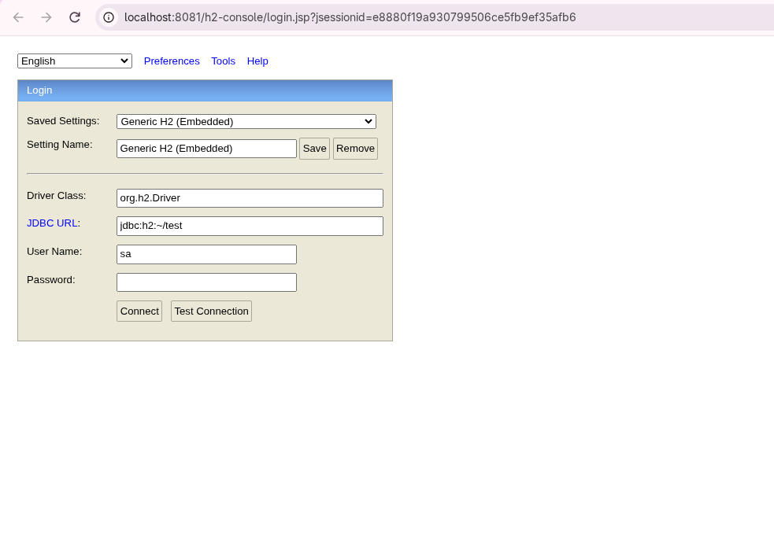

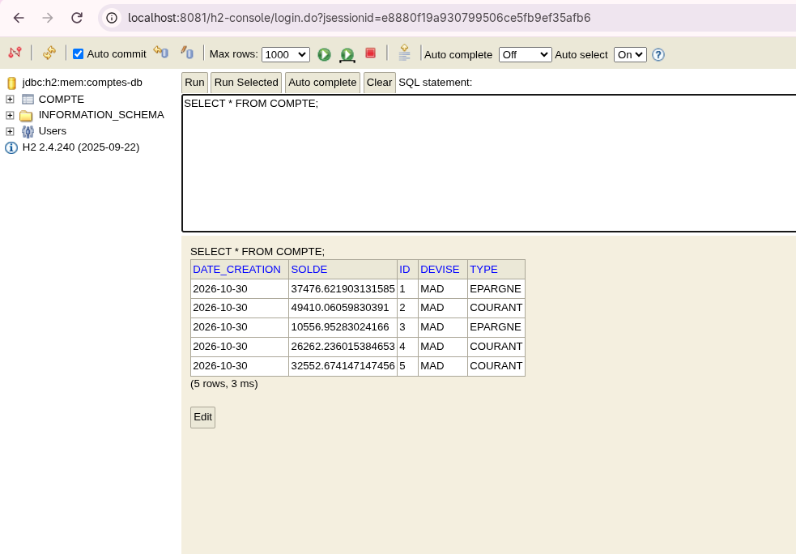

### Étape 5 — Web service RESTful

`CompteRestController` expose les opérations CRUD sous `/api/comptes` :

| Verbe | URL | Action |
|---|---|---|
| GET | `/api/comptes` | Lister les comptes |
| GET | `/api/comptes/{id}` | Consulter un compte |
| POST | `/api/comptes` | Créer un compte |
| PUT | `/api/comptes/{id}` | Modifier un compte (champs envoyés uniquement) |
| DELETE | `/api/comptes/{id}` | Supprimer un compte |

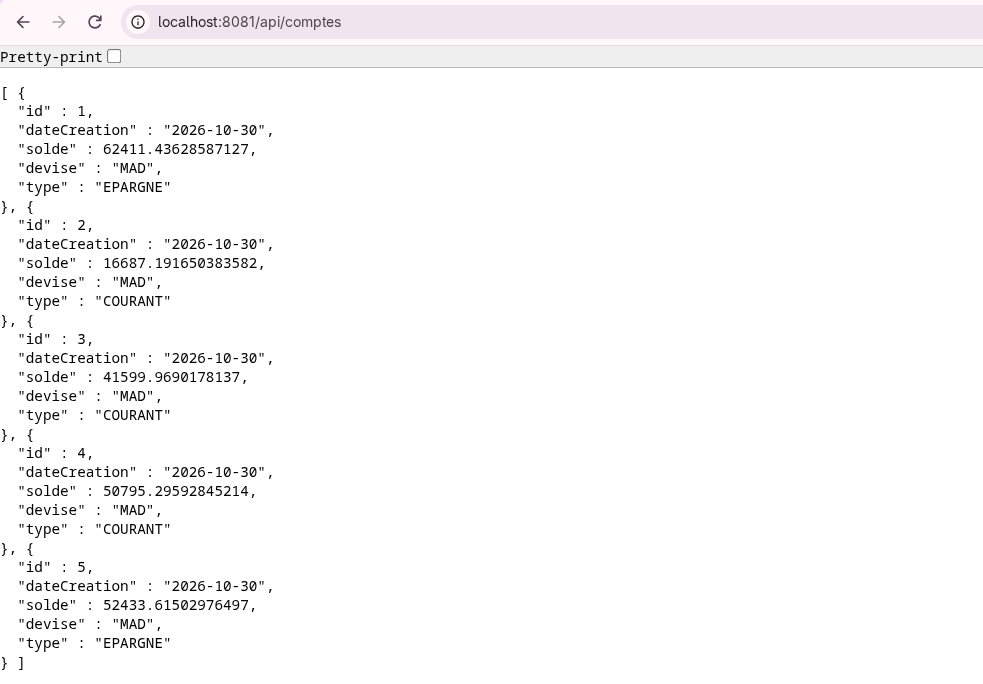

### Étape 6 — Tests avec Postman

| Test | Résultat |
|---|---|
| GET tous les comptes | 200, liste des comptes |
| GET par id | 200, un compte |
| POST | 200, compte créé avec un id généré et la date du jour |
| PUT (solde seul) | 200, solde modifié, devise et type conservés |
| DELETE | 200 |
| GET id inexistant | 500 à ce stade (corrigé en 404 à l'étape 10) |

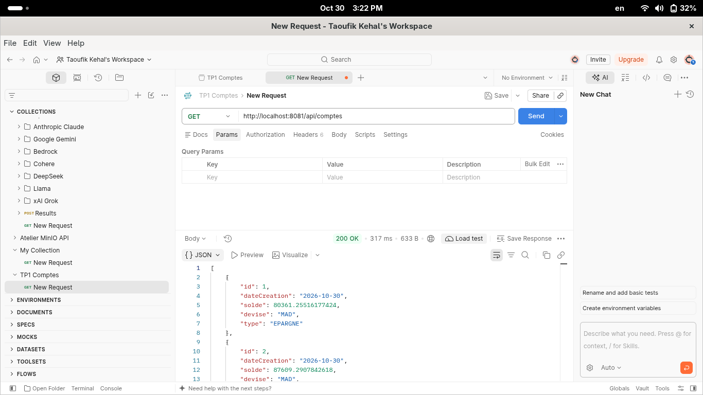
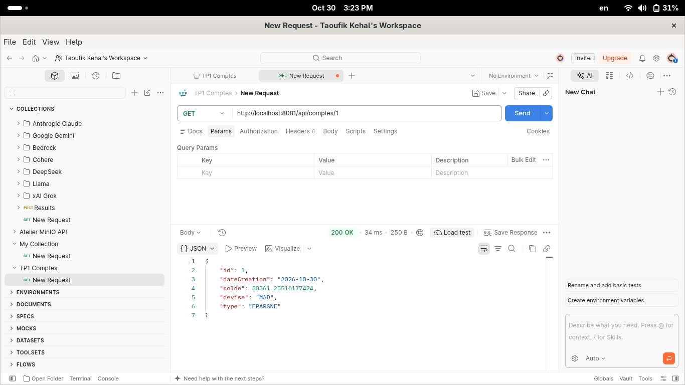
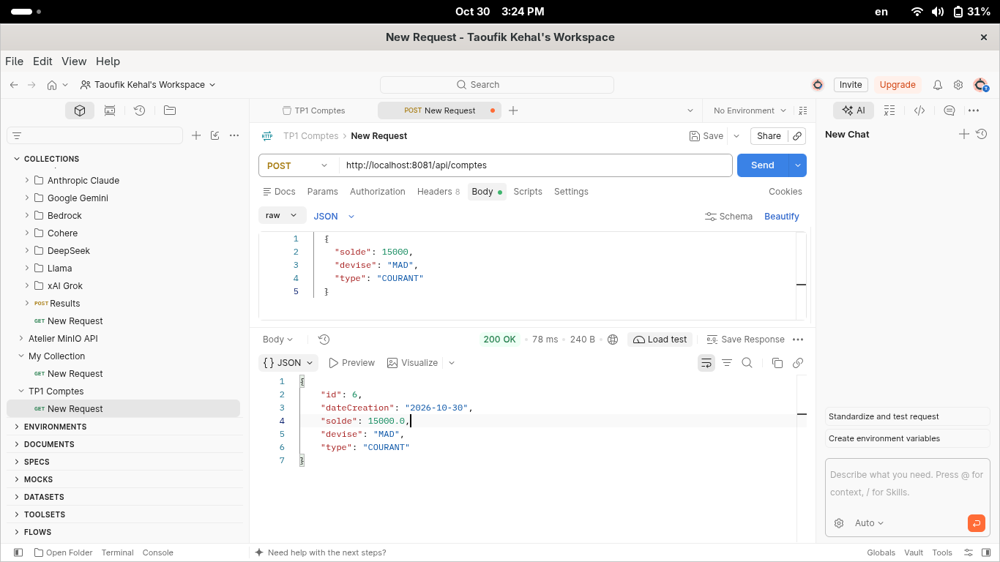
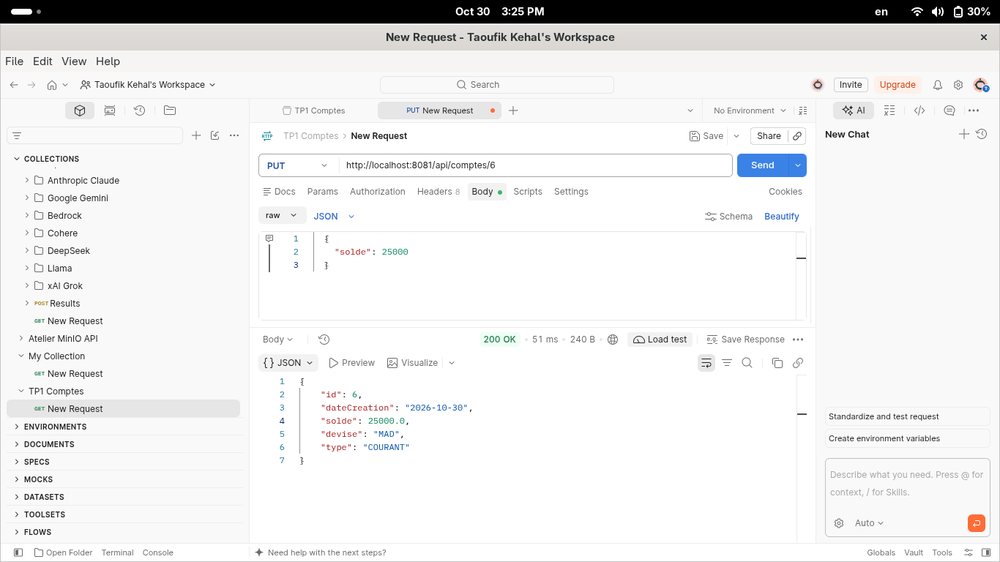
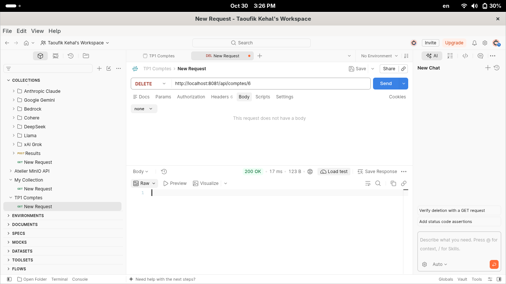
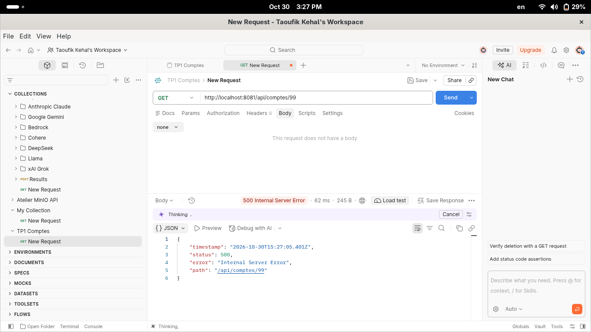

### Étape 7 — Documentation Swagger / OpenAPI

Ajout de `springdoc-openapi-starter-webmvc-ui` (3.0.3). springdoc lit les contrôleurs au démarrage et génère
la description OpenAPI (`/v3/api-docs`) et l'interface Swagger UI (`/swagger-ui.html`).

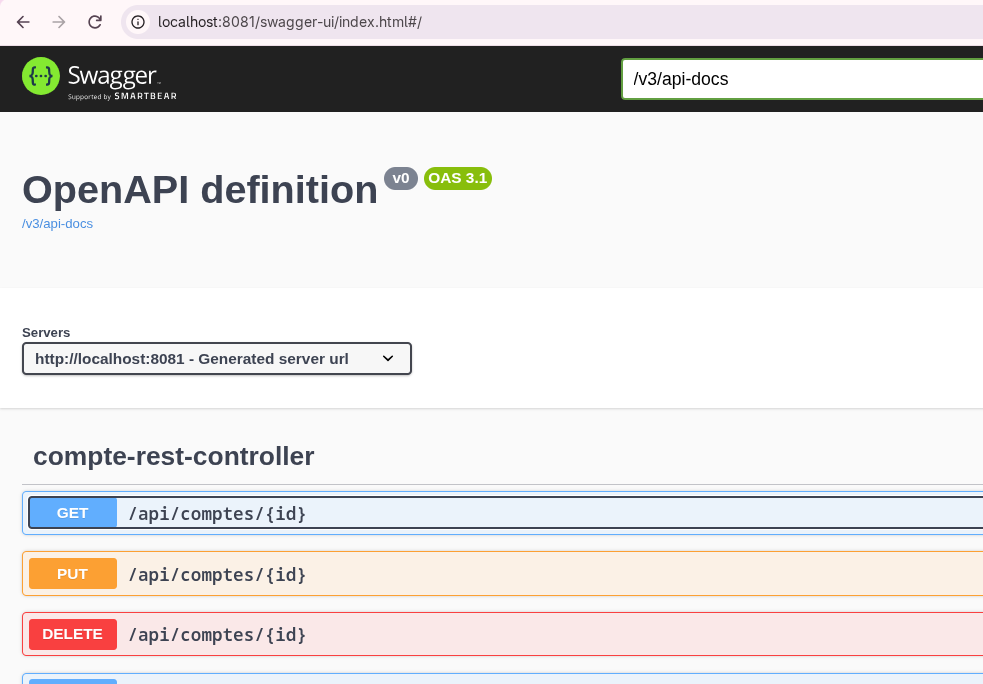
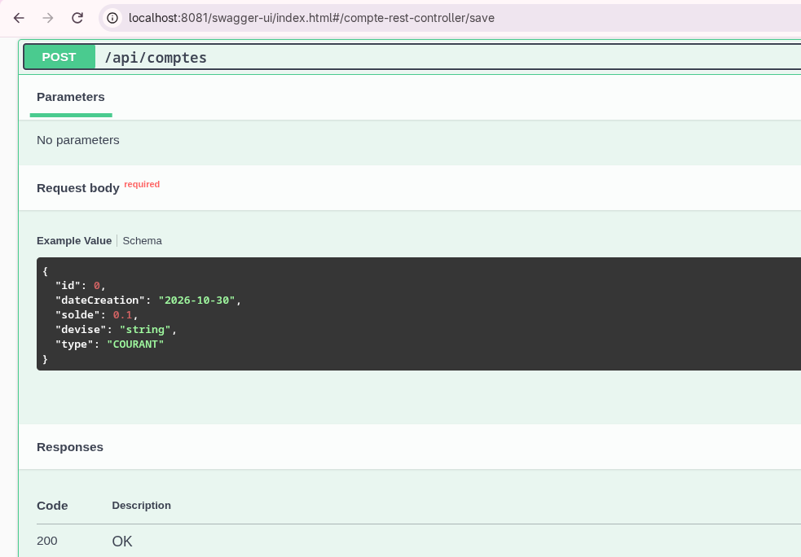

> À cette étape, l'exemple de requête POST contenait `id` et `dateCreation`, car l'entité était exposée directement.
> Ce problème est corrigé à l'étape 9.

### Étape 8 — Spring Data REST et projections

Ajout de `spring-boot-starter-data-rest` : le repository est exposé automatiquement sous `/comptes`, au format **HAL**
(`_embedded`, `_links`, `page`), avec pagination et tri intégrés.

- **Recherche par type** : `findByType` (requête dérivée du nom de la méthode), exposée via `/comptes/search/byType?t=COURANT`.
- **Projection** `solde` : vue partielle de l'entité (`id`, `solde`), via `/comptes?projection=solde`.

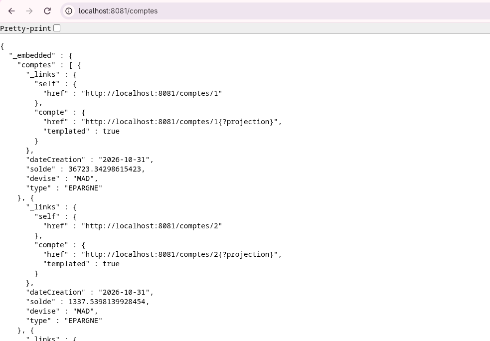

### Étape 9 — DTOs et Mappers

L'API n'expose plus l'entité :

- `CompteRequestDTO` (`solde`, `devise`, `type`) : ce que le client envoie. Il ne peut plus imposer l'`id` ni la date.
- `CompteResponseDTO` (tous les champs) : ce que le client reçoit.
- `CompteMapper` convertit entité ↔ DTO avec `BeanUtils.copyProperties`.

**Avant / après dans Swagger** : l'exemple POST ne contient plus que `solde`, `devise` et `type`.

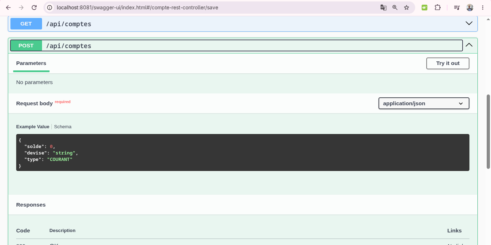

Un `id` envoyé dans le corps est ignoré : le compte reçoit un nouvel id généré.


> **Problème rencontré :** après l'ajout de Spring Data REST, `/v3/api-docs` renvoyait une erreur 500
> (`NullPointerException` dans `SpringDocDataRestUtils.updateResponseSchemaEmbedded`), un bug de springdoc lié à
> la génération OpenAPI 3.1 avec Spring Data REST. **Solution :** `springdoc.api-docs.version=openapi_3_0` dans `application.properties`.

### Étape 10 — Couche service

La logique métier est déplacée dans `CompteService` (interface) et `CompteServiceImpl` (`@Service`, `@Transactional`).
Le contrôleur ne fait plus que traduire les requêtes HTTP en appels au service.

Une exception métier `CompteNotFoundException` annotée `@ResponseStatus(HttpStatus.NOT_FOUND)` remplace l'erreur 500 par un **404**
pour un compte inexistant (consultation et suppression).


### Étape 11 — Web service GraphQL

Ajout de `spring-boot-starter-graphql` :

- Schéma `schema.graphqls` : type `Compte`, input `CompteInput`, enum `TypeCompte`, requêtes `comptes` et `compteById`,
  mutations `saveCompte`, `updateCompte` et `deleteCompte`.
- `CompteGraphQLController` (`@QueryMapping`, `@MutationMapping`, `@Argument`) réutilise **le même `CompteService`** que l'API REST.

Le client choisit les champs retournés : la requête ci-dessous ne renvoie que `id` et `solde`.

```graphql
query { comptes { id solde } }
```

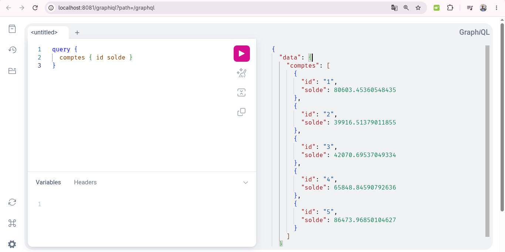

Pour un compte inexistant, GraphQL répond avec un statut HTTP 200 et un tableau `errors` dans le corps de la réponse.

